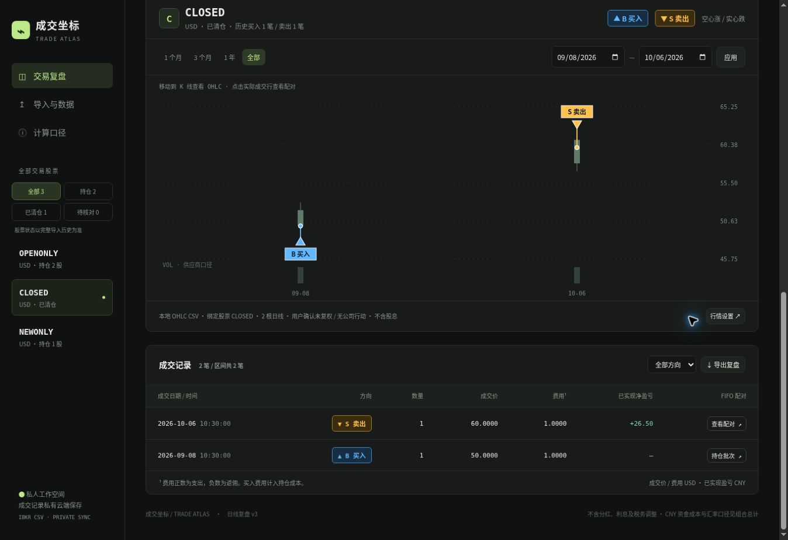
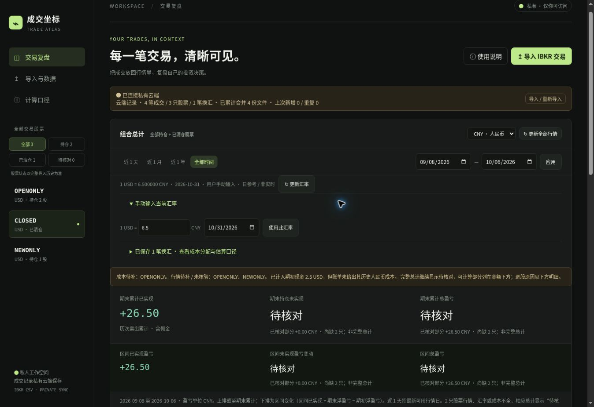

# 成交坐标 · IBKR Trade Atlas

把自己的 IBKR 成交放回股票 K 线中，查看买卖点、FIFO 盈亏，以及持仓和已清仓股票的组合汇总。

原生 JavaScript + Canvas + Cloudflare Worker，零第三方运行依赖。支持本地运行，也可配合私有 Sites 与 D1 持久化保存数据。

## 界面预览

### 买卖点与成交复盘



蓝色 **▲ B 买入**、金色 **▼ S 卖出**与 K 线区分；可按股票、日期和买卖方向筛选，并查看 FIFO 配对。

### 组合总计与数据核对



截图使用虚构股票代码、合成交易和手动测试汇率，不代表真实持仓、真实行情或当前汇率。第二张图展示缺失成本时的保护行为：完整总计标注“待核对”，已核对部分单独显示。

## 功能

- 导入中英文 IBKR Activity CSV、逐笔股票 Flex CSV及标准成交 CSV；`.plain`、`.txt` 扩展名也可读取 CSV 内容。
- 多文件合并与去重：优先使用股票成交 ID，否则匹配完整成交字段；同一秒内不同的交易仍会保留。
- 持仓、已清仓及待核对股票筛选，股票和时间范围独立选择。
- FIFO 按账户、股票和成交币种配对，支持碎股、佣金和已识别的拆股事件；没有卖出时不产生已实现收益。
- 组合按近 1 天、近 1 月、近 1 年、全部时间或自定义区间，展示已实现、未实现及合计。
- USD / CNY 盈亏显示切换。CNY 目前覆盖 USD 股票，股票行情与成交价格仍保留 USD。
- D1 保存规范化成交、换汇与资金流水；浏览器缓存保存视图和行情，刷新不会删除已确认的云端成交。

## 本地运行

需要 **Node.js 24 或更新版本**，不需要安装 npm 依赖。在仓库根目录运行：

```bash
npm test
npm run build
npm run validate
npm run dev
```

打开 `http://127.0.0.1:3000`。停止服务使用 `Ctrl+C`。

本地服务默认只监听本机，使用单一开发测试身份；数据保存在 `.local-state/preview.sqlite`。这一模式用于个人本地使用，不提供生产登录认证，不应直接暴露到公网。

`npm test` 会先生成 Worker，再运行解析、合并、FIFO、资金成本、存储、API 和界面逻辑测试。目前包含 85 项测试。测试中的账户、交易和行情均为虚构数据；接口模拟不保证外部行情源随时可用。

## 导入与使用

1. 在 IBKR 导出包含交易区段的 Activity CSV；人民币成本核算还需要换汇区段、现金报告和相关美元资金流水。
2. 点击“导入 IBKR 交易”，可同时选多份文件，检查预览后合并保存。建议包含首次买入之前的完整记录。
3. 选择股票及时间范围，获取日线；也可在“行情设置”导入该股票的未复权 OHLC CSV。
4. 在组合总计中切换 USD / CNY。缺少当前汇率时，可重试或输入注明日期的手动参考汇率。
5. 遇到“待核对”，查看逐股原因并补齐记录；已知部分不作为完整总计展示。

可用 `examples/` 中的虚构文件熟悉导入流程。`trades.csv` 与 `funding-activity.csv` 可一起导入；`ohlc-closed.csv` 只绑定虚构的 `CLOSED` 股票。

### 标准成交 CSV

```csv
Symbol,Date,Time,Side,Quantity,Price,Fee,Currency
DEMO,2026-01-01,10:00:00,BUY,10,100,1,USD
DEMO,2026-01-02,10:00:00,SELL,4,120,1,USD
```

`Fee` 正数表示费用支出，负数表示返佣。IBKR 原生佣金字段会从带符号现金流转换。更多解析规则见 `src/core.mjs` 与测试。

## 行情与盈亏口径

| 数据 | 处理方式 |
| --- | --- |
| Yahoo 日线 | 尝试读取并应用返回的拆股事件，还原历史价格单位；不使用股息复权收盘价 |
| Nasdaq / Stooq 备用 | 复权口径未核实的价格仅作参考，不参与浮盈亏估值或叠加实际成交点 |
| Twelve Data | 可选服务端 `TWELVE_DATA_API_KEY`；需未复权日线和可用拆股接口同时通过校验 |
| 手工 OHLC CSV | 需要确认股票、币种、未复权价格和公司行动口径 |
| USD/CNY | 最新可用日参考汇率，显示来源与日期；非实时成交报价，过旧或失败时不填默认汇率 |

免费行情可能延迟、缺失或限流；当日日线可能尚未收盘。无法获取时不模拟 K 线。

**人民币成本**按账户追踪实际换得美元的人民币金额，采用美元资金 FIFO 分配到股票买入，再按股票 FIFO 配对卖出。同日正向换汇先归集，属于资金归属估算。CNH 按人民币名义金额记录成本，未计 CNY/CNH 价差、外部银行换汇和汇款费用。

期初美元数量会计入资金余额；若账单没有其历史人民币成本，仅将实际使用这笔资金的成本标为未知，不将其误当欠款重复扣减。

CNY 已实现 = 卖出净美元金额 × 当前参考汇率 − 配对历史人民币成本。卖出所得重新买入时承接相同估值汇率，避免重复计入原始汇兑影响。该数值是股票已实现美元收益的人民币重估，不代表已经换回人民币的现金收益。

历史区间两端使用同一当前参考汇率，不是历史当日的人民币收益曲线。组合不含分红、利息、现金余额和税务调整，也不等同于券商账户净值或税务报表。当前仅支持股票 / ETF 多头；做空、转仓、合并、分拆等需要另行核对。

## 项目结构

```text
src/         CSV 解析、资金与 FIFO 计算、网页、Worker API、存储
scripts/     编译、跨平台构建、本地 SQLite 适配与开发服务
/tests       虚构数据单元与集成测试
/drizzle     D1 初始表结构与迁移元数据
/examples    虚构的成交、换汇与行情 CSV
/docs/images README 界面截图
```

修改 `src/` 后重新运行构建。`worker/` 与 `dist/` 是生成目录，不需要提交。

## 私有部署

生产代码依赖 Sites 注入的可信登录身份，存储按用户隔离。部署到其他平台时，需要先补充等效的认证和访问控制；不要把开发测试身份用于生产。

1. 创建自己的私有 Sites 项目，配置 D1 绑定名 `DB`。
2. 将 `.openai/hosting.example.json` 复制为本地 `.openai/hosting.json`，填入自己的 `project_id`，保持 `d1` 为 `DB`。
3. 通过平台迁移流程应用 `drizzle/` 表结构，再构建并部署 `dist/`。
4. 如需 Twelve Data，在部署平台设置服务端密钥；本地 `.env.example` 仅列出变量名，不会被当前开发脚本自动读取。

配置中的实际项目 ID、密钥、导入文件和数据库不会提交。原始账单应自行保留；规范化数据不包含原文件、姓名、地址或原始账户号码。此仓库不提供现有站点的访问权限或交易数据。

## 收益一致性与可信状态

单股卡片、组合总计及复盘 CSV 共用 `evaluateStock()` / `stockReport()` / `reviewReport()`。只用估值日及以前的行情；超过 7 个自然日、未核验复权、缺失持仓成本或账单持仓不符时，受影响项目显示待核对，导出数值留空。缺失买入费用会传递到持仓成本及后续配对卖出，缺失卖出费用会阻断该笔收益；未知费用不当作完整的零费用结果。未卖出的股票仍为零已实现收益，已清仓股票无需现价即可显示可计算的卖出收益。

每个指标携带 `VERIFIED`（输入已核对）、`ESTIMATED`（估算）或 `INCOMPLETE`（待核对）及原因。`VERIFIED` 仅表示所需输入满足校验，并不表示已经与券商税务或现金账本对账。尚未核验公司行动的成交收益标为估算；参考行情不能用于浮盈亏估值。区间收益使用区间内卖出及两端浮盈亏变化，早期不完整的已实现结果不会无条件污染随后独立可计算的区间卖出。

人民币视图增加独立拆解：

- 股票损益：USD，不含汇兑；股票行情和成交价仍以原币显示。
- 人民币重估总损益：按历史人民币资金成本及当前参考 USD/CNY 汇率计算，始终标为估算。
- 汇率及资金成本影响：人民币重估总损益减去股票 USD 损益按当前汇率的换算值；包括资金 FIFO、换汇费用、CNH 名义成本等差额，不能称为纯汇率收益。
- 实际已兑换收益：未完成本金与利润的现金归属对账前保持待核对。已导入的美元兑回人民币流水可显示实际回款，但回款金额不是利润。

历史区间仍在两端使用同一当前参考汇率，不是历史汇率收益曲线。本次没有增加历史 FX、完整现金净值、XIRR 或完整券商自动对账。

复盘 CSV 新增可信状态、原因、估值日期、期末股票浮盈亏及其状态、显示币种和参考汇率日期。`StockUnrealizedPnLAtEnd` 是同一股票的期末快照，在各成交行重复，**不得逐行相加**。缺失费用保留空白并以 `FeeMissing` 标识。

验证：102 项自动测试通过，含计算手例、单股/组合/导出一致性、费用缺失传递、7 天边界、账户 FIFO 隔离、人民币差额归因、实际回款不等于利润及页面导出行为。托管构建与 Worker 产物校验通过。浏览器检查使用合成数据；不能据此声称已与真实券商全账单完成审计。

## 免责声明
此项目为个人的vibe coding项目，可能会出现各种各样的问题，包括但不限于盈亏计算有误，使用本项目的用户，不应该依靠本项目的数据进行理财和投资。本项目不对任何理财和投资负责。

理财有风险，投资需谨慎。
